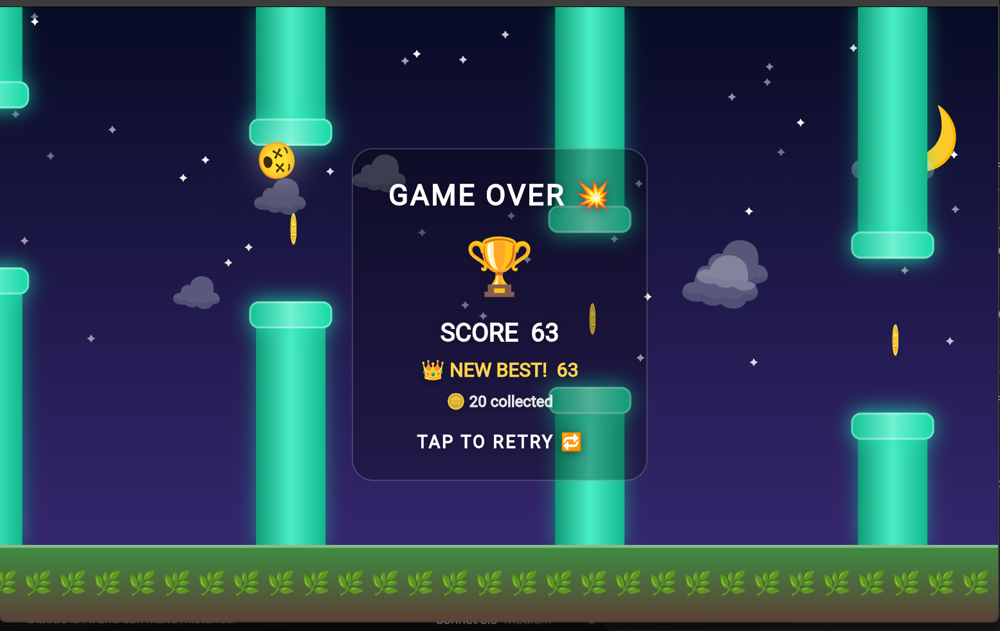

# 🦉 Sky Dash

An endless flyer built with **Flutter** and **Dart**. Tap to flap, dodge the glowing pipes, grab spinning coins, and watch your bird evolve while the sky moves from day to night. The whole game is drawn in code with emojis and gradients, with no image assets.

Built from the GDG's Darted Pixels workshop starter, then redesigned with custom visuals, a day/night cycle, coins, particles and a polished UI.



## ✨ Features

- **Evolving bird:** your bird changes as you score: 🐤 → 🐦 → 🦉 → 🦅 → 🐲 (every 10 points).
- **Day/night cycle:** the sky fades through ☀️ day → 🌅 sunset → 🌙 night → 🌄 dawn, with twinkling stars and drifting clouds.
- **Coins:** spinning 🪙 sit in every gap and give bonus points.
- **Rising difficulty:** pipes speed up and the gaps shrink as your score grows.
- **Game feel:** particle bursts, screen shake on a crash, and a glowing neon pipe style.
- **Glass UI:** frosted score panels, a game-over card with medals (🥉 🥈 🥇 🏆), and a "NEW BEST" highlight.
- **Sound and haptics:** uses Flutter's built-in `SystemSound` and `HapticFeedback`, so it needs no extra packages.
- **Controls:** tap, click, or press **Space**.

## 🚀 Run it

You need the [Flutter SDK](https://docs.flutter.dev/get-started/install) installed.

```bash
git clone https://github.com/Xaiiiidddd/sky-dash.git
cd sky-dash
flutter pub get
flutter run -d chrome
```

You can also use `-d windows` or any connected device.

## 🗂️ Project structure

```
lib/
├── main.dart                  # The Sky Dash game (screen, physics, visuals, sound)
└── workshop/
    ├── student_code.dart      # The 9 workshop tasks: colors, gravity, gap, speed, name
    └── game_settings.dart     # Central settings for the original Flame game
```

## 🎛️ Customize it

Open `lib/workshop/student_code.dart` and change the values:

| Task | Function | What it controls |
|------|----------|------------------|
| 1 | `getBirdColor()` | Bird color |
| 2 | `getGravity()` | How fast the bird falls |
| 3 | `getGapSize()` | Gap between pipes |
| 4 | `getPipeSpeed()` | How fast the pipes move |
| 5 | `calculateJumpStrength()` | Flap power (scales with gravity) |
| 6 | `getPipeColor()` | Pipe color |
| 7 | `getSkyTopColor()` / `getSkyBottomColor()` | Daytime sky colors |
| 8 | `calculatePoints()` | Points per pipe |
| 9 | `getCreatorName()` | Name shown on the title screen |

Save, then hot reload with `r` (use `R` for a full restart after changing constants).

## 🛠️ Built with

- Flutter / Dart
- `CustomPaint`-free rendering: widgets, emojis and gradients only
- A `Ticker`-driven game loop

## 👤 Author

**Zaid**: [github.com/Xaiiiidddd](https://github.com/Xaiiiidddd)

Made during the GDG workshop. Fly high! 🚀
